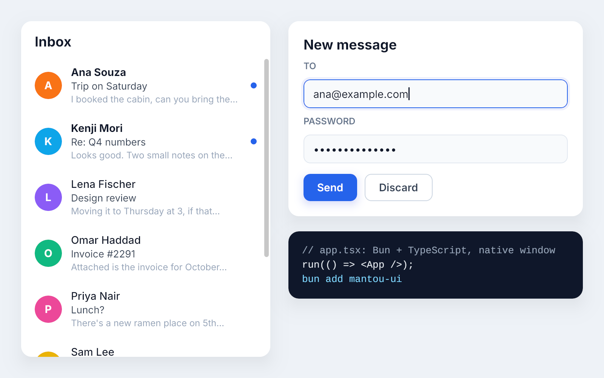
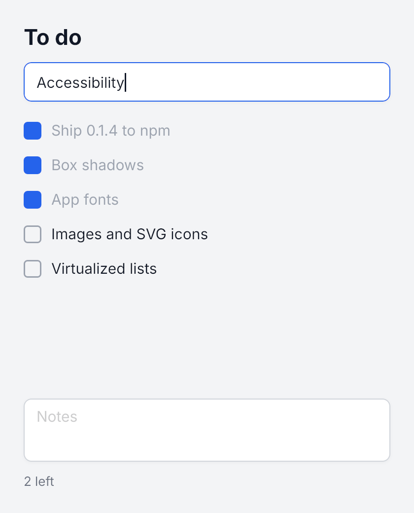

# Mantou

Native desktop apps in TypeScript, on Bun. You write Solid-style JSX; a Rust core draws it on the GPU in a real window. No browser, no webview.



```tsx
import { Text, View, createSignal, run } from "mantou-ui";

function App() {
  const [on, setOn] = createSignal(false);
  return (
    <View style={{ width: 120, height: 48, borderRadius: 8, justifyContent: "center", backgroundColor: on() ? "#16a34a" : "#4b5563" }} onPress={() => setOn(!on())}>
      <Text style={{ color: "#ffffff", fontWeight: 600, textAlign: "center" }}>{on() ? "On" : "Off"}</Text>
    </View>
  );
}

run(() => <App />);
```

> **Early development.** Works on Linux, macOS and Windows: flexbox layout, text and custom fonts, text input (with IME), scrolling, images and SVG icons, rounded corners, borders, shadows, animations, hover and cursors. Accessibility is next.

## Use it

Needs [Bun](https://bun.sh) 1.4.4. A new app (a counter with a test, and an AGENTS.md):

```bash
bunx -p mantou-ui mantou create my-app
```

Or in a project you have:

```bash
bun add mantou-ui
```

```bash
bunx mantou run src/main.tsx
```

In `tsconfig.json`, set `"jsx": "preserve"` and `"jsxImportSource": "mantou-ui"`; for `bun test`, preload `mantou-ui/preload` in `bunfig.toml`. The native core comes prebuilt for Linux, macOS and Windows.

## From Rust

The core is Rust, and the `mantou` crate drives it without JavaScript: build nodes and styles, get events back, in one ~25 MB executable. It's the low-level layer (no components or reactivity); see [Using Mantou from Rust](https://mantou.dunkbing.dev/guide/rust/).

## With an agent

Mantou is built to be driven by coding agents: every app runs headless, and `mantou snap` prints the screen as text (each node's `testId`, text and box as drawn), writes screenshots, plays scripted input and checks motion. Give your agent this:

> Build me a <thing> with Mantou (github.com/dunkbing/mantou). Start with `bunx -p mantou-ui mantou create my-app`, read its AGENTS.md, and check your work headlessly with `bun run snap` and `bun test`.

## Examples

From a clone of this repo (`bun install`, then `bun run build:core`, which needs [Rust](https://rustup.rs)):

```bash
bun run todos
```

```bash
bun run showcase
```



For a real app, see [Mantou Mail](https://github.com/dunkbing/mantou-mail): an email app with mailboxes, a message list, a reader and keyboard shortcuts. It uses Mantou from npm, like any app would.

## Docs and contributing

The guide, the design and test results are at [mantou.dunkbing.dev](https://mantou.dunkbing.dev) (source in [`website/`](website/)). Found a bug or need a feature? [Open an issue](https://github.com/dunkbing/mantou/issues/new/choose). Working on the code, as a person or an agent? Start with [AGENTS.md](AGENTS.md).
