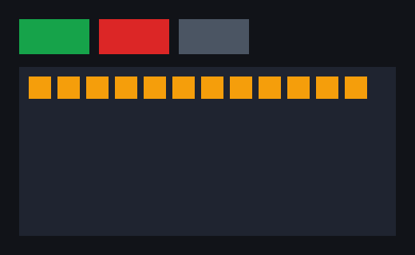

M1 turns the M0 spike into the core loop of the framework: the Worker builds a UI tree, sends it to the native core as **ops**, and the core lays it out and draws it. The exit criteria are in the [roadmap](/design/roadmap/).

## What works

**The protocol has one source of truth.** [`schema/protocol.ts`](https://github.com/dunkbing/mantou/blob/main/schema/protocol.ts) defines every op, node kind, style property and event. `bun run gen` writes the TypeScript bindings (`runtime/gen/protocol.ts`), the Rust bindings (`core/crates/mantou-tree/src/protocol.rs`) and a golden op batch (`schema/fixtures/basic.*`). The TypeScript encoder writes that batch; the Rust decoder must decode it to exactly what the TypeScript decoder does. `bun run gen:check` fails CI when anything is stale.

**The shadow tree** (`mantou-tree`, no platform dependencies):
- **Applying batches:** whole batches are validated first, and a malformed one changes nothing. Ops that make no sense (unknown ids, cycles) are skipped and counted.
- **Moves:** a node already in place is never re-inserted.
- **Styles:** shared styles (`STYLE_DEF`/`STYLE_USE`) with per-node overrides.
- **Layout:** flexbox through Taffy, rounded to device pixels by Mantou rather than Taffy.
- **Output:** a scene of rectangles, and hit-testing for presses.

**The renderer** (`mantou-render`): solid rectangles drawn as instanced quads with wgpu, colours converted to linear for sRGB targets.

**The FFI core** (`mantou-ffi`):
- **Commits** apply, lay out and publish a new scene on the Worker's thread.
- **The main thread** draws the latest scene and lays out again on resize without involving JS.
- **Presses:** a press (down and up on the same node) whose path has a listener is sent as a `PRESS` event.

**The runtime** (`runtime/ui.ts`):
- **Nodes:** a mirror tree of `Node`s with `style`, `use`, `append`, `insertBefore`, `remove`, `release` and `onPress`. Presses bubble, and `stopPropagation` stops them.
- **Batching:** one commit per JS turn.
- **Ids:** released ids are reused.
- **Testing without a window:** `runtime/mock.ts` records decoded commits.

**The counter example** (`examples/counter`, `bun run counter`): there's no text yet, so the count is shown as squares and in the window title.

## Results

**Unit tests:**
- `cargo test`: 11 Rust tests (tree, layout, hit-testing, shared styles, malformed batches, and the cross-language fixture).
- `bun test`: 13 TypeScript tests (encoder/decoder round trip, colours, validation, op counts, moves, bubbling, listening, id reuse, the counter).

**Window self-test** (`bun run selftest`, Linux, Xvfb, Mesa lavapipe): 9/9 checks pass. The five M0 checks still pass, plus:

| Check | Result |
|---|---|
| Ops → tree → layout → quads | The counter's first commit is 44 ops in one batch → 5 quads, 0 op errors; the + button is laid out at 88 px wide |
| Press → handler → commit → frame | A press is hit-tested by the core, reaches the handler, and its commit (exactly **4 ops**: `CREATE`, `STYLE_USE`, `INSERT`, `TITLE`) is on screen about **13 ms** later |
| No press without a listener | A press on a node with no listener on its path sends nothing |
| Relayout without JS | While the Worker is blocked for 0.8 s, 8 resizes produce 8 layouts and 8 frames with **0 commits** |

## Still to do in M1

- **Headless instance:** the multi-instance C ABI with `mt_headless_new`, `mt_test_step` and `mt_test_stats` (see [§12.2](/design/testing/#122-headless-mode-core-support)). Until then, platform-free tests run in Rust against `mantou-tree` directly, and window tests use the test hooks `mt_test_pointer` and `mt_test_node_rect`.
- **Decoder fuzzing** (`cargo fuzz`), and property tests comparing incremental layout with layout from scratch.
- **Window CI on macOS and Windows** for the M1 checks. They're in the same self-test, so the next CI run covers them.
