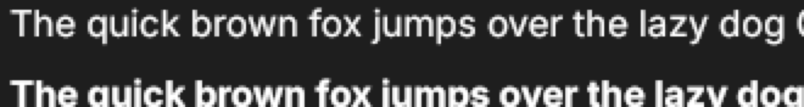
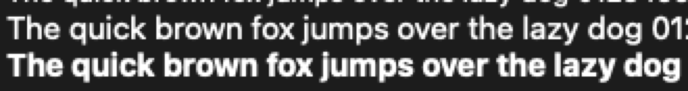

[#27](https://github.com/dunkbing/mantou/issues/27). Checked on 2026-11-04 on a Mac mini (Apple M4, macOS 27.0.1, Metal) with an external 1920 × 1200 display at 1× (so no Retina), Bun 1.4.4 and Rust 1.98.1. The window self-test passes 13/13 (the same self-test passes in CI).

Most checks were driven rather than done by hand: real key events posted to the running window's process, the window and menu bar read through the accessibility API (System Events), and window-only screenshots with `screencapture -l`. That reaches what a keyboard does through AppKit, but it isn't a person at the machine, so the checks that need one are listed at the end.

## Keyboard (single-line `<Input>`, text "one two three")

| Keys | Result |
|---|---|
| Option+Left, Option+Left ×2 | The caret moves by word |
| Cmd+Left, Cmd+Right, Home, End | To the line's start and end |
| Cmd+Backspace, Option+Backspace | Delete to the line's start; delete the word before the caret |
| Shift+Left, Option+Shift+Left, Cmd+Shift+Left | Extend the selection by character, word and to the line's start |
| Cmd+A, Cmd+C, Cmd+X, Cmd+V, Cmd+Z, Cmd+Shift+Z | All work, with the Edit menu installed (see [Menus and native dialogs](/progress/platform-services/)) |
| Cmd+Q | Asks the window to close; the app exits |
| Cmd+W | Closes the window (after [#33](https://github.com/dunkbing/mantou/issues/33)) |
| `secure` input focused | Secure keyboard entry on while it has the focus in the key window, off otherwise (after [#32](https://github.com/dunkbing/mantou/issues/32)) |

The secure field is also exposed to assistive technology as a secure text field.

## Dead keys and Option characters

Option+S gives ß. **Dead keys leave a stray letter**: Option+E then E gives `eé`, Option+U then U gives `uü`, and Option+E then Space gives `e ` instead of `´`. The same events sent to TextEdit give a clean `é`, so the events are faithful. winit reports the dead key's key-down as the plain letter `e` with the text `e` and sends no IME preedit, which the core inserts. **Not yet confirmed on a real keyboard**; if it happens there too, it gets its own issue.

## Text

The same lines at the same sizes, white on dark, Mantou (Inter) above and TextEdit (the system font) below, magnified 4×:

- Shapes and sizes line up; Inter is a little wider, so a line wraps about one character earlier.
- Mantou's regular weight is a little lighter than macOS's, which is what unhinted grayscale rasterization looks like next to Core Text's; bold matches well.
- Nothing is wrong enough to say a Core Text backend is needed on this evidence. The larger difference is the typeface, which `fontFamily` and app fonts ([#14](https://github.com/dunkbing/mantou/issues/14)) address. Whether the lighter weight is "noticeable" is a judgement for someone looking at it on a Retina display, which this machine doesn't have.

## Windows

- Live resize through the accessibility API (700 × 500, 300 × 400, 900 × 700, back): the window follows, the layout adapts, no errors.
- The default menus: App (About, Hide, Hide Others, Show All, Quit), Edit, Window (Close Window, Minimize, Zoom, Full Screen).

## Needs a person

- [ ] **Dead keys on the real keyboard**: Option+E then E in the first field of `bun runtime/main.ts examples/todos/main.tsx`: `é`, or `eé`?
- [ ] **IME:** Japanese (Kotoeri) and Chinese (Pinyin) composition in an `<Input>`: the candidate window at the caret, marked text underlined, commit and cancel; Korean (2-Set) jamo; the emoji picker (Ctrl+Cmd+Space).
- [ ] **Trackpad:** two-finger scrolling with momentum in a `<Scroll>`, horizontal scrolling, scrolling while the app is busy.
- [ ] **Windows:** full screen, and moving between a Retina and a non-Retina display (this Mac has only a 1× display).
- [ ] Cmd+H and Cmd+M.
