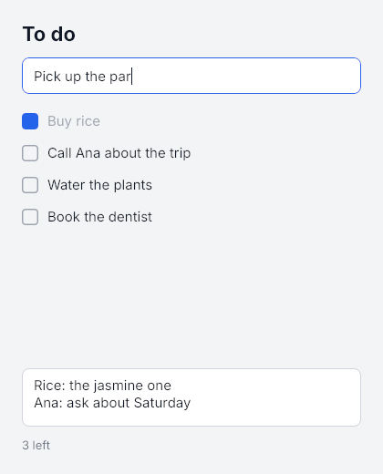

## `<Input>`

```tsx
import { Input, createSignal } from "mantou-ui";

const [draft, setDraft] = createSignal("");

<Input
  value={draft()}
  onChange={setDraft}
  onSubmit={(text) => { send(text); setDraft(""); }}
  placeholder="Write a message"
  style={{ height: 36, paddingLeft: 10, borderWidth: 1, borderColor: "#d1d5db", borderRadius: 8, fontSize: 15 }}
/>
```

| Prop | |
|---|---|
| `value` + `onChange` | Controlled: the text follows the signal. If the app changes what the user typed (uppercasing, say), the input shows the app's text; if the app doesn't update the signal at all, the input goes back to it |
| `defaultValue` | Uncontrolled: the text it starts with; the core keeps it from then on, and `onChange` still reports every change |
| `onSubmit` | Enter in a single-line input, Ctrl+Enter (⌘+Enter on macOS) in a multiline one |
| `onFocus`, `onBlur` | The keyboard focus came or went (by a press, Tab, `node.focus()`, `node.blur()`, or a press elsewhere) |
| `placeholder` | Shown while it's empty, in `placeholderColor` (default: the text colour at 40%) |
| `multiline` | Enter adds a line; the input grows with its text unless its height is set |
| `maxLength`, `readOnly` | Checked in the core, so no keystroke has to wait for JS to be refused. Read-only text can still be selected and copied |
| `secure` | A password field: a bullet per character, copy and cut refused (paste works), and the window tells the OS it's a password field, so platforms that support it turn the IME and suggestions off. Flip it for a "show password" toggle. The app still gets the real text in `onChange` |
| `autoFocus` | Focus it when it's created; later changes to it do nothing (call `node.focus()` to move the focus) |
| `style` | A `<View>`'s box properties and a `<Text>`'s text properties, plus `caretColor` and `selectionColor` |

Without a width from its style or its parent, an input is 200 px wide (like a browser's), and it has no minimum width, so it shrinks in a row. A single-line input is one line tall plus its padding, with its text centred vertically.

The `Node` behind it has `focus()`, `blur()`, `focused`, `value` (the text as the core last reported it), `setValue()`, `placeholder()` and `setOptions()`, for code that uses the node tree directly.

## Editing

The core does all of it, on the main thread for the window, without a round trip through JS:

- **Caret and selection:** arrows, Home and End, Shift to select; word by word with Alt (macOS) or Ctrl; line start and end with ⌘ on macOS; Up and Down between lines of a multiline input. Press to place the caret, drag to select, double-press for a word, triple-press for the line, Shift+press to extend.
- **Deleting:** Backspace and Delete, a word at a time with Alt (macOS) or Ctrl, to the line's start with ⌘+Backspace on macOS.
- **Shortcuts:** select all, copy, cut, paste, undo and redo, with ⌘ on macOS and Ctrl elsewhere (also Ctrl+Y to redo). Typing is grouped into one undo step per word. The window uses the system clipboard (X11 on Linux, so XWayland on Wayland); each headless instance has its own.
- **IME:** compositions are drawn in place, underlined, and only become the value when the IME commits them. The IME's candidate window is placed at the caret.
- **Focus:** Tab and Shift+Tab move through the inputs in tree order, selecting the new one's text. A press outside any input blurs.
- **Scrolling:** a single-line input scrolls sideways to keep the caret in view, and so does a multiline input with a fixed height, vertically.

**Keys the focused input uses don't reach `onKey`** (typing, arrows, Backspace, Enter, Tab, its shortcuts), so an app's single-letter shortcuts don't fire while the user types. Escape, Up and Down in a single-line input, PageUp and PageDown, and shortcuts the input doesn't know (⌘+K, say) still reach the app.

## How it works

- `CREATE` kind `Input`, then `PLACEHOLDER`, `INPUT_OPTIONS` (flags and the maximum length) and `VALUE` ops; `FOCUS` gives or takes the focus ([§8.3](/design/protocols/#83-text-input)).
- When the user changes the text, the core sends `TEXT_CHANGED` with the text in the event record and a `rev` that counts the user's edits. Event records now have a variable length: the first word's high half says how many words follow the usual four.
- `VALUE` carries the `rev` the app last saw. The core ignores a value older than the user's latest edit, so the app's answer to "ab" can't erase the "c" typed since; the app then hears about "abc" and answers again.
- **Op counts:** typing in an uncontrolled input sends nothing from JS. In a controlled one the echo (`onChange` setting the signal to the same text) sends nothing either; a value that differs is one `VALUE` op. Typing two letters in the window's self-test draws them with no commit and no key events in JS.

## Not yet

Caret blinking; character filters (`allow`) and `inputMode`; the selection in the API (reading it, or setting it from the app); focus for views other than inputs; scrolling a multiline input with the wheel; Emacs-style Control bindings on macOS; a context menu; accessibility.

## Tests

- **Editor** (`mantou-text`): typing, word movement and deletion, undo grouping and redo, newlines in single-line and multiline inputs, the maximum length and read-only, IME composition, the caret kept in view, the pointer, replacing the text from the app.
- **Tree** (`tests/input.rs`): focus by press and blur by pressing elsewhere, which keys are used, shortcuts and the clipboard, multiline growth and Ctrl+Enter, Tab order, stale and fresh `VALUE` ops, options, double-press and drag, what the scene draws (placeholder, caret, selection), the IME, releasing the focused input.
- **Headless** (`tests/input.test.tsx`): the same on the real core through `<Input>`, plus controlled inputs (echoes, transforms, a value the app holds fixed), submit-and-clear, keys reaching `onKey` or not, and a 128 KiB change, twice the event buffer, arriving whole. `HeadlessCore` gained `type`, `insertText`, `compose`, `clipboard`, `value`, `focused`, and `key(…, { primary: true })` for the platform's shortcut key.
- **Mock core** (`runtime/input.test.tsx`): the ops an input sends, in order (options before the value, so a multiline value keeps its newlines).
- **Window:** the self-test types into an input and checks that the text reaches JS with no commit and no key events. The to-do example (`bun run todos`) was also driven with real X11 keystrokes and clicks under Xvfb: typing, Enter, Ctrl+A then Backspace, Tab into the notes, Shift+Home, double-press, and copying and pasting through the system clipboard.
