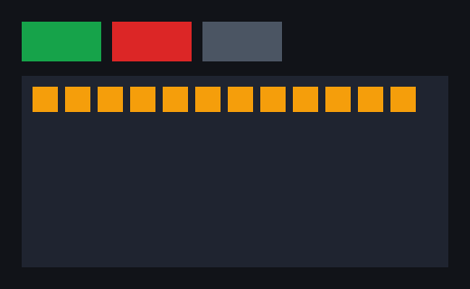

## Mantou Mail

[Mantou Mail](https://github.com/dunkbing/mantou-mail) is a mail client built only with what Mantou can do today, on sample data. It started in this repo and now lives in its own, where it uses Mantou the way any app does, as the `mantou-ui` package:
- **Sidebar:** all inboxes, each account, starred, snoozed, sent, archive and trash, plus labels, with unread counts.
- **Message list:** Important and Other tabs, and rows with an avatar, sender, time, subject, preview, unread dot, star and chips ("Waiting for reply", "Snoozed until", labels).
- **Reader:** the message, its labels, and quick replies (sending adds the reply to Sent).
- **Toolbar and status bar:** Archive, Reply, Older, Newer, Delete, and the last action with undo.
- **Keyboard:** `j`/`k` move, `e` archives, `#` deletes, `s` stars, `u` toggles unread, `r` opens quick replies (then `1`–`3` sends one), `z` undoes, `1`/`2` switch tabs.
- **Scrolling:** the wheel scrolls the list and the reader; the selected row is kept in view.

It runs in a window, where its first frame appears about 0.7 s after launch on Linux (mostly Babel compiling the app's JSX), and on headless instances: its tests cover opening, keyboard triage and undo, tabs, the wheel, quick replies, the sidebar and captured pixels.

It was built before Mantou had [text input](/progress/text-input/), so it has no compose window or search yet.

## What the framework gained

| | |
|---|---|
| **Text** | `<Text>` with `color`, `fontSize`, `fontWeight`, `lineHeight`, `textAlign`, `fontStyle` and `maxLines` (with an ellipsis). Laid out in the core with parley, measured by Taffy, rasterized with swash into a glyph atlas ([§8.5](/design/protocols/#85-text)) |
| **Boxes** | `borderRadius`, `borderWidth`, `borderColor`: an SDF in the quad shader. Borders inset the content, as CSS's `border-box` |
| **Clipping** | `overflow: "hidden"` clips descendants, intersected down the tree; hit-testing ignores what's clipped away |
| **Input** | Keys with modifiers and named keys (`onKey`), the wheel (`onWheel`, bubbling like presses) |
| **Measuring** | `node.measure()`: where the core laid a node out, after committing the changes made so far |
| **Headless** | `HeadlessCore.key()` and `.wheel()`, and a `glyphs` counter |

## Tests

- **Text engine** (`mantou-text`): wrapping, the ellipsis, centred lines, weights, the layout cache, rasterization and atlas growth.
- **Tree** (`tests/text.rs`): text measured and wrapped, glyph quads, ellipsis inside the box, clipping, borders insetting content, a clipping box smaller than its content, text that keeps its logical layout across scale factors.
- **Incremental vs from scratch:** the random-change model now has text nodes, text changes and every text and box property. After each frame the incremental tree still equals one rebuilt from scratch, boxes to the bit.
- **Fuzzing:** the same three targets, with text in the `layout` target.
- **Headless and window:** the counter's labels and count, keys, and Mantou Mail.

## Findings

- **Flexbox minimum sizes apply.** A flex item is at least as tall as its content unless it clips, which matches CSS. A scrolling list in a fixed-height window needs `minHeight: 0` on the flex containers around it, as in CSS. Mantou had to tell Taffy about `overflow: hidden` as well as clip, so a clipping box can be smaller than its content.
- **`flexShrink` defaults to 1**, as in CSS, so fixed-size parts (sidebars, avatars) need `flexShrink: 0`.
- **Fonts once per process.** Building a font context per tree (system font scan plus Inter) made the layout property test 35× slower. The context is now built once and cloned, and each tree creates its text engine only when its first text node appears.
- **Comparing scenes:** atlas positions depend on the order glyphs were first drawn, so trees are compared on everything else (a glyph's size, place, colour and clip).
- **fontconfig keeps memory from its one-time setup**, which LeakSanitizer reports when fuzzing. `core/fuzz/lsan.supp` suppresses it.
