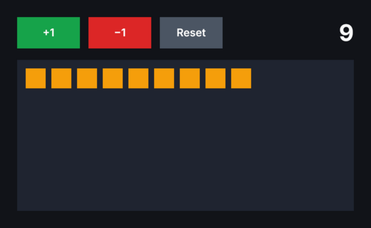

The Worker builds a UI tree and sends it to the native core as **ops**; the core lays it out and draws it. This page records what works and how it's tested.

## What works

**The protocol has one source of truth.** [`schema/protocol.ts`](https://github.com/dunkbing/mantou/blob/main/schema/protocol.ts) defines every op, node kind, style property and event. `bun run gen` writes the TypeScript bindings (`runtime/gen/protocol.ts`), the Rust bindings (`core/crates/mantou-tree/src/protocol.rs`) and a golden op batch (`schema/fixtures/basic.*`). The TypeScript encoder writes that batch; the Rust decoder must decode it to exactly what the TypeScript decoder does. `bun run gen:check` fails CI when anything is stale.

**The shadow tree** (`mantou-tree`, no platform dependencies):
- **Applying batches:** whole batches are validated first, and a malformed one changes nothing. Ops that make no sense (unknown ids, cycles) are skipped and counted.
- **Moves:** a node already in place is never re-inserted.
- **Styles:** shared styles (`STYLE_DEF`/`STYLE_USE`) with per-node overrides.
- **Layout:** flexbox through Taffy, rounded to device pixels by Mantou rather than Taffy.
- **Output:** a scene of rectangles, and hit-testing for presses.

**The renderer** (`mantou-render`): solid rectangles drawn as instanced quads with wgpu, colours converted to linear for sRGB targets. It draws to a window's surface or offscreen.

**The native core** (`mantou-ffi`, C ABI version 3): every UI is an **instance** with its own tree, scene, events and counters; the window is one (`mt_app`).
- **Window:** commits apply, lay out and publish a new scene on the Worker's thread. The main thread draws the latest scene and lays out again on resize without involving JS. A press (down and up on the same node) whose path has a listener is sent as a `PRESS` event.
- **Headless instances** (`mt_headless_new`, [§12.2](/design/testing/#122-headless-mode-core-support)) run without a window, synchronously on the caller's thread, with a manual clock: input (`mt_test_input`), viewport (`mt_test_viewport`), stepping (`mt_test_step`), hit-testing, node boxes, a text dump of the scene (`mt_test_scene`) and offscreen captures (`mt_test_capture`).

**The runtime:**
- **Nodes** (`runtime/ui.ts`): a mirror tree of `Node`s with `style`, `use`, `append`, `insertBefore`, `remove`, `release` and `onPress`. Presses bubble, and `stopPropagation` stops them.
- **Batching:** one commit per JS turn.
- **Ids:** released ids are reused.
- **Tests:** `runtime/mock.ts` records decoded commits; `runtime/headless.ts` (`HeadlessCore`) drives a real headless instance.

**The counter example** (`examples/counter`, `bun run counter`): a Solid component, `Counter.tsx`, written with `View`, `createSignal`, `Index` and shared styles. When this page was written there was no text, so the count showed as squares; it now has labels and the count as text ([Text and Mantou Mail](/progress/text/)).

**The Solid layer** ([§7.2](/design/runtime/#72-components-reactivity-compiled-jsx)):
- **Compilation:** `.tsx` files are compiled by a Bun plugin (`runtime/solid/plugin.ts`) with `babel-preset-solid` in universal mode; compiled JSX calls the renderer in `runtime/solid/renderer.ts`.
- **Rendering:** Solid's universal renderer over the mirror tree; `<View>` takes `style` (own properties, a shared style, or a list of them), `onPress` and `ref`. Nodes are released when the Solid owner that created them is disposed.
- **Entry points:** `run(app)` renders in the window from the Worker; `mount(ui, app)` renders into any `Ui`, which is how tests use the mock core and headless instances.

## Tests

| Suite | Command | What it checks |
|---|---|---|
| Tree unit tests | `bun run test:core` | Layout, moves, release, cycles, malformed batches, device-pixel snapping, presses, shared styles |
| Cross-language fixture | `bun run test:core` | Rust decodes the TypeScript-encoded batch exactly as the TypeScript decoder does |
| Incremental vs from-scratch layout | `bun run test:core` | 400 random UIs × 40 frames of random valid changes, plus 10 runs of 400 frames: after each frame, every node's box and the whole scene equal those of a tree rebuilt from scratch, **to the bit** |
| Random and corrupted batches | `bun run test:core` | 20,000 random batches and 3,000 corrupted valid ones never panic, and the tree stays consistent (`Tree::check`) |
| Fuzzing | `cargo +nightly fuzz run <target>` in `core/fuzz` | `decode` (any bytes), `apply` (any batches, then layout, scene, hit-testing, consistency), `layout` (fuzzer-driven valid changes, incremental vs from scratch) |
| Runtime | `bun run test` | Encoder/decoder round trip, colours, validation, op counts, moves, bubbling, listening; the Solid counter against the mock core: one batch for the first render, **4 ops** per square, one commit for several presses in a turn, everything released on dispose |
| Headless core | `bun run test:headless` | The Solid counter on the real core without a window: layout, presses (a press commit is exactly **4 ops**), wrapping, releasing, resizing at 2×, `<Show>` adding and removing nodes, captured pixels, independent instances |
| Window | `bun run selftest` | The threading checks, plus, with the Solid counter: ops → layout → quads; a press → handler → one commit → frame (about 7–13 ms); no press without a listener; relayout while the Worker is blocked (8 resizes → 8 layouts, 0 commits) |

**Fuzzing so far** (60 s per target, Linux): `decode` 5.5 million runs, `apply` 657,000, `layout` 98,000; no failures. The random batch test found one bug before that: a `STYLE_DEF` with a garbage property count reserved memory for it before checking it, and a count of 2³² aborted the process. The count is now checked against the op's length first, with a regression test.

**Layout gap found by the headless tests:** with `flexWrap`, CSS's default `align-content: stretch` spreads wrapped rows over the container's height. The protocol had no `alignContent`, so rows couldn't be packed at the top; it does now.
